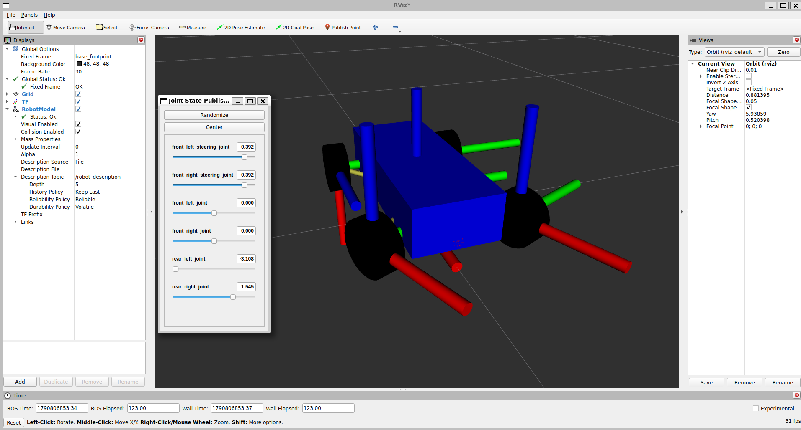
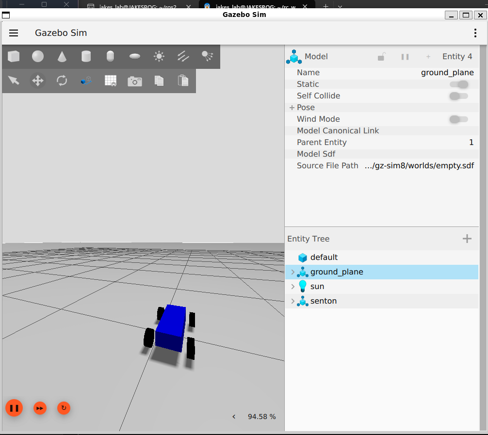
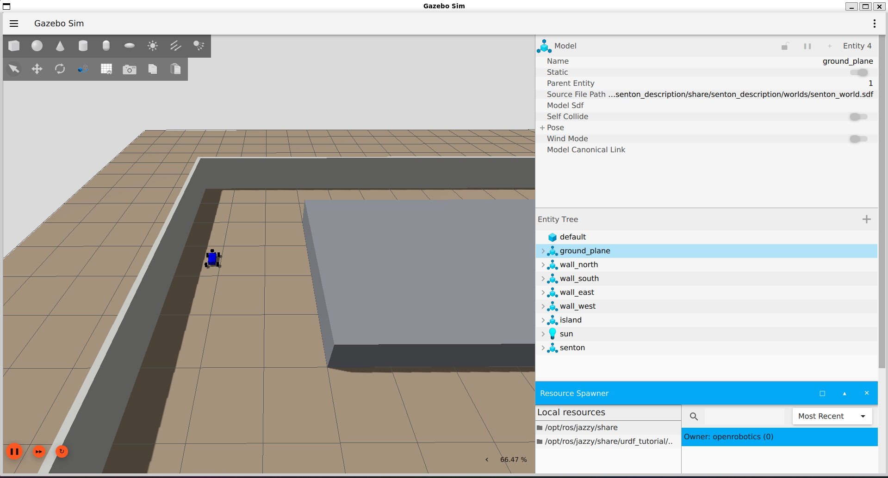
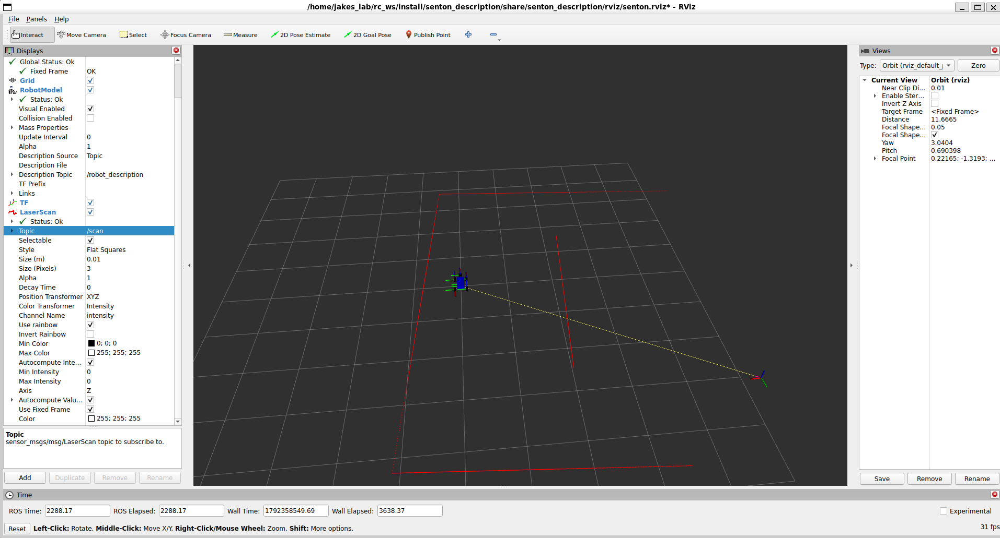

# Autonomous RC Car

An autonomous 1/10-scale RC car built with ROS 2 Jazzy on the ARRMA SENTON 223S BLX platform.

The project is being developed simulation-first, with the goal of mapping a track, localising the vehicle, planning racing trajectories, avoiding obstacles, and eventually overtaking a moving opponent using a classical robotics stack deployed on physical hardware.

> **Status:** 🚧 Active development
> The SENTON vehicle model is implemented in Xacro and simulated in Gazebo Harmonic with collision geometry, inertial properties, ROS 2 Control integration, Ackermann steering, rear-wheel traction and vehicle odometry. The physical ARRMA SENTON platform has been ordered. Mapping, planning, perception and physical deployment remain in development.

---

## Overview

Development is simulation-first: the autonomy stack is built and validated in Gazebo against a parameterised vehicle model, then transferred to the physical car. This decouples software progress from hardware assembly and allows rapid iteration without battery charges or crash risk.

The autonomy pipeline:

```text
Sensors
   ↓
Perception / SLAM
   ↓
Localisation
   ↓
Track / Obstacle Representation
   ↓
Trajectory Planning
   ↓
Path Tracking
   ↓
Vehicle Control
```

The engineering focus is the racing-specific planning and path-tracking layers, which will be implemented specifically for this project rather than relying on a complete existing navigation stack. Standard ROS 2 infrastructure is used where appropriate for simulation, transforms, low-level vehicle control and odometry.

---

## Platform

### Vehicle

| Component | Specification |
|---|---|
| Chassis | ARRMA SENTON 223S BLX |
| Scale | 1/10 |
| Drivetrain | 4WD |
| Steering | Ackermann-style front steering |
| Motor | Spektrum 3100Kv brushless |
| Vehicle mass | 3.55 kg |

### Compute and Sensors

| Component | Hardware |
|---|---|
| Compute | NVIDIA Jetson Orin Nano Super |
| LiDAR | Slamtec RPLIDAR S2 |
| Depth Camera | Luxonis OAK-D S2 |
| IMU | Bosch BNO085 |
| Motor Control | VESC 6 |
| Power | Main LiPo with regulated DC-DC supply for compute/sensors |

The LiDAR and camera mount to a single rigid bracket so their extrinsics remain fixed and can be calibrated once.

---

## Vehicle Parameters

| Parameter | Value |
|---|---:|
| Vehicle length | 558 mm |
| Vehicle width | 305 mm |
| Vehicle height | 210 mm |
| Wheelbase | 327 mm |
| Track width | 263 mm |
| Wheel diameter | 104 mm |
| Wheel width | 42 mm |
| Vehicle mass | 3.55 kg |

Dimensions are taken from manufacturer specifications and tyre measurements. Chassis body geometry in the model is a simplified approximation and will be refined against the physical vehicle.

---

## Current Robot Model



*Current Xacro vehicle model visualised in RViz with TF frames, front steering assemblies and independently rotating wheels.*

## Gazebo Simulation



*ARRMA SENTON model running in Gazebo Harmonic with collision geometry, inertial properties and ROS 2 vehicle control.*

### Closed-Course Test Environment



*Custom closed-course Gazebo environment with perimeter walls and a central island for LiDAR, SLAM, localisation and planning experiments.*



*Simulated RPLIDAR S2 scan visualised in RViz, showing the course boundaries and central island from the `/scan` topic.*

Implemented:

- `base_footprint` ground reference frame
- `base_link` positioned at wheel-axis height
- Four wheel links generated from a reusable Xacro macro
- Separate front steering knuckle links and steering joints
- Collision geometry for the chassis and wheels
- Inertial properties for the chassis, wheels and steering knuckles
- Gazebo Harmonic vehicle spawning
- `ros2_control` integration through `gz_ros2_control`
- Simulated joint-state feedback through `joint_state_broadcaster`
- Ackermann steering control
- Rear-wheel traction in simulation
- Passive front wheel rotation
- Vehicle-level velocity commands using `TwistStamped`
- Controller-generated vehicle odometry
- Gazebo simulation clock bridged into ROS 2
- Automatic controller spawning from the Gazebo launch file

The simulation uses a rear-wheel-drive Ackermann abstraction even though the physical SENTON is mechanically 4WD. This provides a close match to the kinematic bicycle model used by the planned path-tracking and trajectory-planning stack while avoiding unnecessary drivetrain complexity at the targeted operating speeds.

---

## Software Stack

| Component | Technology | Status |
|---|---|---|
| Middleware | ROS 2 Jazzy | Implemented |
| Transform system | TF2 | Implemented |
| Simulation | Gazebo Harmonic | Implemented |
| Vehicle control | `ros2_control` + `ackermann_steering_controller` | Implemented |
| Vehicle odometry | Ackermann controller odometry | Implemented |
| Mapping / Localisation | SLAM Toolbox | Planned |
| Obstacle representation | `nav2_costmap_2d` | Planned |
| Local trajectory planning | Frenet-frame trajectory generation | Planned |
| Path tracking | Regulated Pure Pursuit | Planned |
| Opponent tracking | LiDAR clustering + state estimation | Planned |
| Compute target | NVIDIA Jetson Orin Nano Super | Hardware available |

---

## Design Decisions

### Custom Frenet-frame planner


The planned local planner is a custom Frenet-frame trajectory generator. Candidate trajectories will be sampled as lateral offsets from a reference racing line and scored on lateral deviation, curvature, smoothness, obstacle clearance, vehicle constraints and duration.

This representation is well suited to racing because trajectories are expressed relative to the track rather than as arbitrary motions through a global Cartesian map. The time component of each trajectory will also provide the foundation for dynamic-opponent avoidance and overtaking.
### Standalone costmap rather than the full Nav2 stack

Nav2's behaviour tree and lifecycle management are designed around differential-drive indoor navigation. For an Ackermann vehicle running a custom planner at speed, that machinery adds complexity without benefit.

`nav2_costmap_2d` will be used as a library for obstacle representation while custom planning and control nodes handle racing-specific trajectory generation and tracking — taking advantage of mature ROS infrastructure without inheriting an architecture built for a different problem.

### Classical robotics first

The first version uses classical planning and control rather than learned driving policies. Reinforcement learning for racing requires substantial training infrastructure and transfers poorly from simulation to hardware, whereas classical controllers transfer reliably and remain interpretable — which allows localisation, planning, tracking and control to be evaluated independently.

Learned perception components are scoped as a later phase, where they offer a clear advantage over geometric methods.

---

## Repository Structure

```text
senton-autonomous-rc/
├── README.md
├── docs/
│   └── images/
│       ├── senton_rviz.png
│       └── senton_gazebo.png
└── src/
    └── senton_description/
        ├── CMakeLists.txt
        ├── package.xml
        ├── config/
        │   └── controllers.yaml
        ├── launch/
        │   ├── display.launch.py
        │   └── gazebo.launch.xml
        ├── rviz/
        │   └── senton.rviz
        └── urdf/
            ├── senton.urdf.xacro
            └── senton_properties.xacro
```

Additional packages for simulation, control, planning and perception will be added as the project grows.

---

## Running the Simulation

### Requirements

- Ubuntu 24.04
- ROS 2 Jazzy
- Gazebo Harmonic
- `ros_gz_sim`
- `ros_gz_bridge`
- `gz_ros2_control`
- `ros2_control`
- `ros2_controllers`
- `ackermann_steering_controller`
- `topic_tools`
- Xacro
- RViz2

### Build

```bash
cd ~/rc_ws
colcon build --packages-select senton_description --symlink-install
source install/setup.bash
```

### Launch the simulation

```bash
ros2 launch senton_description gazebo.launch.xml
```

This starts Gazebo Harmonic, spawns the vehicle, brings up the controllers and opens RViz.

### Drive the vehicle

Send a velocity and yaw-rate command to the Ackermann controller:

```bash
ros2 topic pub -r 20 /ackermann_controller/reference geometry_msgs/msg/TwistStamped \
"{header: {frame_id: base_link}, twist: {linear: {x: 0.5}, angular: {z: 0.5}}}"
```

The controller converts this into per-wheel steering angles and rear-wheel velocities, and publishes odometry on `/ackermann_controller/odometry`.

### Visualise the kinematic model only

To inspect the URDF and TF tree in RViz without simulation:

```bash
ros2 launch senton_description display.launch.py
```

The Joint State Publisher GUI exposes the wheel and front steering joints, allowing the kinematic structure and TF tree to be verified manually.

---

## Roadmap

### V1 — Autonomous Racing (LiDAR)

**Vehicle model**
- [x] Create ROS 2 description package
- [x] Parameterise vehicle dimensions using Xacro
- [x] Model four wheels with a reusable macro
- [x] Add `base_footprint` and `base_link`
- [x] Add front steering knuckles
- [x] Verify steering and wheel joints in RViz
- [x] Add simplified chassis geometry
- [x] Add collision geometry and inertial properties
- [x ] Add LiDAR, camera and IMU frames
- [ ] Refine chassis dimensions from physical measurements

**Simulation and vehicle control**
- [x] Create Gazebo world and spawn vehicle
- [x] Integrate `ros2_control` with Gazebo
- [x] Publish simulated joint-state feedback
- [x] Implement Ackermann steering
- [x] Implement rear-wheel traction model
- [x] Add vehicle-level velocity interface
- [x] Generate vehicle odometry
- [x] Bridge Gazebo simulation clock into ROS 2
- [x] Publish `odom -> base_footprint` transform
- [ ] Replace TF relay with native controller TF publishing
- [ ] Add simulated LiDAR, camera and IMU

**Mapping and localisation**
- [ ] Validate odometry against Gazebo ground truth
- [ ] Build track map using SLAM Toolbox
- [ ] Implement localisation
- [ ] Generate reference racing line

**Planning and control**
- [ ] Implement Frenet trajectory generator and scoring
- [ ] Implement regulated pure pursuit controller
- [ ] Integrate obstacle costmap
- [ ] Static obstacle avoidance

**Dynamic racing**
- [ ] Detect and cluster moving opponent from LiDAR
- [ ] Track opponent state with a Kalman filter
- [ ] Predict opponent trajectory
- [ ] Incorporate dynamic obstacles into trajectory scoring
- [ ] Implement overtaking behaviour

**Physical deployment**
- [x] Select and order ARRMA SENTON 223S BLX platform
- [ ] Measure physical chassis and update simulation geometry
- [ ] Finalise sensor mounting and 3D-printed electronics deck
- [ ] Integrate Jetson compute platform
- [ ] Integrate motor and steering control
- [ ] Design regulated power distribution for compute and sensors
- [ ] Calibrate sensors and transforms
- [ ] Transfer autonomy stack from simulation
- [ ] Closed-course testing and sim-to-real tuning

### V2 — Vision Layer

- [ ] OAK-D stereo depth integration
- [ ] RTAB-Map visual SLAM
- [ ] Object detection on the OAK-D VPU
- [ ] Detection-to-costmap integration
- [ ] Sensor fusion evaluation

---

## References

- F1TENTH autonomous racing research and educational material
- Werling et al., *Optimal Trajectory Generation for Dynamic Street Scenarios in a Frenét Frame*, IEEE ICRA, 2010
- SLAM Toolbox
- ROS 2 and Navigation2 documentation

---

## Author

**Jakes Jacob Mathew**
BSc (Hons) Artificial Intelligence
